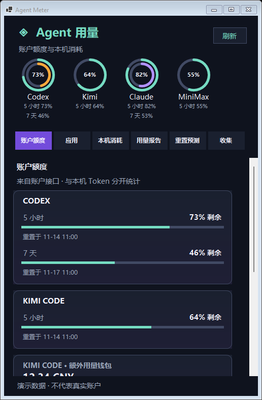

<div align="center">

# Agent Meter for Windows

**AI coding usage, one glance away.**

A Windows system-tray companion for account limits and local agent usage, built on [Gary23333/agent-meter](https://github.com/Gary23333/agent-meter).

[简体中文](README.md) · [Getting started](#getting-started) · [Privacy](#privacy-and-data) · [Contributing](#contributing)

[](https://github.com/FoxBai/agent-meter-windows/actions/workflows/windows-port.yml) [](LICENSE)

</div>

> **Early Windows port.** The app is under active development. The Windows release does not yet contain every provider, feature or interface from the original macOS project.



The Alpha 10 screenshot was generated with fictional demo data on an isolated Windows runner; window borders may vary by Windows version. Actual availability depends on the agent, account, local files and version. See also the [local usage](windows/assets/usage-preview.png), [calendar report](windows/assets/report-preview.png), [reset forecast](windows/assets/forecast-preview.png), [collection](windows/assets/collection-preview.png), [DeepSeek balance](windows/assets/deepseek-preview.png) and [share card](windows/assets/report-share-preview.png) previews.

## What it does

- **System tray panel** — left-click the tray icon to show or hide the panel; right-click to open, refresh or quit. Closing the panel keeps the app in the tray.
- **Account switches** — enable or disable Codex, Kimi, Claude, MiniMax and DeepSeek account lookups independently from the tray menu. Local history is unaffected. The per-user preferences contain only switches, never credentials; MiniMax and DeepSeek are off by default.
- **Low-quota alerts** — optionally enable Windows notifications below 20% remaining; repeat alerts for the same window are suppressed. Alerts default to off, and actual notification display still needs device testing.
- **Desktop pet (in development)** — includes the upstream Mochi and Bit sprite packs, hidden by default. Users can show, switch and drag them from the tray menu; animations respond to low quota and recent local updates. Transparency and interaction still need device testing, and the upstream 3D characters and full interactions are not yet ported.
- **Appearance** — choose from seven named palettes and card styles in the tray menu; the choice is remembered. The Windows port does not yet reproduce all macOS materials or animations, and visual review is ongoing.
- **Codex account** — shows quota windows, reset times, credits and reset cards when the Codex account service returns them. A missing value is not treated as zero.
- **Grouped accounts** — quota windows from the same provider share one card for easier comparison. The new layout needs device testing.
- **Two-window gauges** — pairs a short window with the seven-day window where available, or shows a single ring otherwise. The layout still needs device testing.
- **Kimi Code account** — reads an already-running local Kimi service without launching it; validated with a simulated server, not yet with a real Windows account.
- **Claude Code account** — queries Anthropic's usage endpoint when an existing local subscription credential file is present, without refreshing or changing the login. Tested with simulated credentials and responses only.
- **MiniMax Code accounts** — supports up to five separately queried accounts, with keys stored in Windows Credential Manager. Lookup is off by default. If the account-list file does not exist, existing `MINIMAX_TOKEN_PLAN_KEY` and `MINIMAX_REGION` environment variables can also be used. Synthetic tests only; real accounts and the editor still need device testing.
- **DeepSeek API balance (in development)** — users can add or delete an API key from the tray menu; saving it enables balance lookup and stores it in Windows Credential Manager. It uses the [official balance endpoint](https://api-docs.deepseek.com/api/get-user-balance/), does not read browser sessions or environment keys, and is tested with synthetic data only; real accounts and the editor still need device testing.
- **Local usage** — reads supported session ledgers and displays today, 7-day, 30-day and all-time token totals. Qoder CN local credits are shown separately and never added to tokens. Account quota and local usage are separate measures.
- **Application activity** — summarizes recent local records by client, including how many were updated in the 15 minutes before collection. This is a recency signal, not proof a process is running or a task succeeded. Coverage varies.
- **Model ranking and daily trend** — ranks models over the past 7×24 hours and charts the latest seven calendar days in Beijing time. Incomplete sources are flagged; separate local ledgers can overlap.
- **Calendar reports** — shows local totals for the current and previous calendar week and month, indicating that the current period is incomplete. It can export a Markdown summary or a themed PNG share card. Export interaction still needs device testing.
- **Reset forecasts (in development)** — an optional third-party forecast page shows each site's 24-hour and 48-hour estimates, labels model-based fallbacks and displays update times when available. Disabled by default. Synthetic tests passed; two of three sites returned usable data in one isolated network check, while the interface still needs device testing. Forecasts are not an OpenAI promise or an account's own reset clock.
- **Collection (in development)** — derives daily, lifetime, streak, multi-app and personal-record medals from local daily ledgers using upstream rules. Ledgers can overlap and incomplete sources are flagged. Other medals and non-quota collectible cards are not ported; the page still needs device testing.
- **Quota cards (in development)** — applies upstream five-hour and seven-day thresholds, recording each tier once per window. Quota state and card counts are stored locally; a missing trustworthy quota or reset time never becomes a drop. The interface and real accounts still need device testing.
- **API-equivalent estimates** — shows today's USD estimate for models with matching prices. Missing prices, breakdowns or peak/off-peak information are flagged. The tray menu can edit local USD overrides to the upstream built-in snapshot. Built-in prices may be outdated; some CNY prices use the fixed fallback rate of 7.25 CNY per USD. This is neither subscription spend nor a bill. Live price and exchange-rate updates are not yet available.
- **Background refresh** — account data can appear while history is still being scanned. Manual refresh and a 15-minute timer are available. Parsed usage is cached in memory while the app is running; changed files are reread.

## Data sources

The table describes the current `main` branch. Check the release notes for the exact contents of each download.

| Source | Account quota | Local token history |
| --- | --- | --- |
| Codex | Quota and reset time; credits and reset cards when available | Codex sessions and archives |
| Claude Code | Existing local subscription credential (synthetic validation) | Local project sessions |
| Gemini CLI | Not yet | Local chat sessions |
| WorkBuddy | Experimental opt-in web login and credit lookup (synthetic validation) | Local project sessions |
| ZCode | Not yet | Local CLI usage database |
| DeepSeek Harness | Not yet | Local session logs, including supported compressed logs |
| DeepSeek API | API balance, explicit key and opt-in (synthetic validation) | No direct local history; DeepSeek Harness is separate |
| Kimi Code / legacy Kimi CLI | Existing Kimi Code local server (synthetic validation) | Local session logs |
| OpenCode | Not yet | Local v1 message database; v2 records are flagged as incomplete |
| MiniMax Code | Up to five separate accounts or an environment-variable key, explicitly enabled (synthetic validation) | Local usage database |
| MiMo Code, DevECo | Not yet | Local usage databases |
| Qoder CN | Not yet | Local credits consumed, not token usage or account balance |

The new Kimi, OpenCode, MiniMax Code, MiMo Code, DevECo and Qoder CN readers have synthetic Windows tests; they have not been validated against real installations on this Windows machine. OpenCode's v2 messages are not yet counted. The application reports only data it can read. A provider or account may omit fields or use an unsupported format. Local history is limited to records on this computer; it is not necessarily the same as account-wide usage, invoices, or remaining plan quota. Period boundaries currently use **Asia/Shanghai**. Credits from different services are not combined.

## Getting started

### Requirements

- Windows x64, with the agents you want to inspect installed and configured. This port has been exercised on Windows build 26300; other versions and Windows ARM64 still need validation.
- To build: Python 3.10 and the .NET 8 SDK. The resulting self-contained bundle includes its Python backend and .NET runtime.
- For Codex account quota, a working, signed-in `codex.exe` must be on `PATH` or in the Codex Desktop installation directory. No account login is performed by Agent Meter.

### Download the preview

Download [Windows v0.1.0-alpha.12](https://github.com/FoxBai/agent-meter-windows/releases/tag/windows-v0.1.0-alpha.12), extract `AgentMeter-Windows-x64.zip`, and run `AgentMeter.Windows.exe` from the extracted folder. The portable bundle includes the application runtime; WorkBuddy requires a separately installed WebView2 Runtime. The preview is not code-signed; the release page includes a SHA-256 checksum. The complete tray lifecycle, themes and a separate clean physical installation have not yet been verified.

### Build from source

In PowerShell from the repository root:

```powershell
py -3.10 -m venv .venv-win
.\.venv-win\Scripts\python.exe -m pip install -r windows\requirements.txt
powershell -NoProfile -ExecutionPolicy Bypass -File windows\build.ps1
.\windows\dist\AgentMeter\AgentMeter.Windows.exe
```

Keep the complete `AgentMeter` output folder together. Find the icon in the Windows notification area; Windows may place it under the hidden-icons arrow. The first local scan can take time when there are many sessions. Later refreshes reuse the in-memory cache, subject to its size limit and source changes.

For a synthetic preview without reading accounts or local history:

```powershell
.\windows\dist\AgentMeter\AgentMeter.Windows.exe --demo
```

`--window` opens a normal taskbar window for troubleshooting with real data. It is not required for ordinary tray use. To stop the app, right-click the tray icon and choose **退出** (Quit).

### Tests

```powershell
powershell -NoProfile -ExecutionPolicy Bypass -File windows\test.ps1
dotnet build windows\AgentMeter.Windows -c Release
```

These are targeted tests, not a claim that every upstream macOS feature is covered on Windows. Some upstream suites require additional tools or contain platform-specific assumptions.

## Privacy and data

The Windows adapter reads local session files and usage databases; it derives usage metrics rather than displaying conversation text. The activity reader accesses timestamps and project-path metadata but passes only per-application counts and update times to the interface, not session IDs, paths or content. Parsed usage is held in a bounded in-memory cache and is discarded when the app exits. The Windows interface does not upload this history or require an Agent Meter account. Codex, Kimi and Claude account lookups default to on; MiniMax and DeepSeek default to off. Switch states are saved without credentials in `%LOCALAPPDATA%\AgentMeter\preferences.json`. Custom prices and appearance are stored as `prices.json` and `appearance.json` in the same directory; a malformed price file hides estimates and shows a notice. Codex account refresh starts the locally installed Codex app-server, which uses the existing Codex login and may contact the provider. If a Claude Code subscription credential file exists, the app reads its access token in memory and sends it over HTTPS to Anthropic's usage endpoint; it does not refresh or modify that token.

Third-party forecasts are off by default. Enabling them contacts `willreset.com`, `codex-reset.com` and `codexreset.org` over HTTPS without sending account credentials or local sessions. Public forecast data and history are cached in `%LOCALAPPDATA%\AgentMeter\reset-forecast.json`; disabling the switch does not erase this cache or retract requests already sent.

The DeepSeek API key is added by the user and stored in Windows Credential Manager. When enabled it is passed to the local backend over standard input and sent over HTTPS to the official balance endpoint, not written to the command line or app logs. The feature does not read browser sessions or environment keys; users can delete the saved key from the tray menu.

The experimental WorkBuddy feature is off by default and requires the separately installed [WebView2 Runtime](https://developer.microsoft.com/microsoft-edge/webview2/). It uses an app-owned profile under `%LOCALAPPDATA%\AgentMeter\webprofiles\workbuddy`, never the user's existing browser profile. Canceling login retains local data; the clear button removes local browsing data but does not log out on the server. When enabled, cookies and the user agent pass to the local backend through standard input and are sent to the upstream project's WorkBuddy HTTPS usage endpoint, which is not a stable public API contract. The app stops when it cannot confirm profile isolation; even unrelated WebView2 policies may prevent use. Top-level and popup navigation is restricted to HTTPS on WorkBuddy, QQ and Tencent domains; downloads and external apps are blocked, so some login methods may not work. Real accounts and sign-in flows remain unverified.

Quota cards pass only the needed quota fields and multi-account labels to a local process over standard input, and store observed quota windows, peaks, reset times and card counts in `%LOCALAPPDATA%\AgentMeter\collection.json`, without keys or session content. Multi-account labels are distinguished by a hash; renaming an account starts a new tracking identity. Disabling account lookup stops new reads but does not delete existing local cards. An unreadable ledger is not overwritten as empty.

User-added MiniMax keys are stored in Windows Credential Manager; `minimax-accounts.json` contains labels, regions and random IDs, not keys. When enabled, keys are passed to the local backend through standard input and sent over HTTPS to the selected MiniMax usage endpoint, never in command-line arguments or application logs. The environment-variable fallback applies only when the account-list file is absent; clearing the list in the interface retains an empty file and does not re-enable it. Disabling a source attempts to stop an ongoing account lookup; a request already sent cannot be recalled. The app does not initiate model prompts or credit redemption.

This Windows port is independent of the optional reward-claiming features in the upstream macOS application; those controls are not exposed by the Windows interface. Check the code and the provider's own policies if your environment has restrictions on local session access.

## Troubleshooting

- **No tray icon:** open the hidden-icons menu in the notification area. Start with `--window` to inspect the panel.
- **No Codex quota:** confirm `codex.exe` is available and signed in, then refresh. A network or service failure can also make account data unavailable.
- **No local history:** run the agent on this Windows account and check the corresponding local history exists. `CODEX_HOME`, `CLAUDE_CONFIG_DIR`, `DSH_HOME`, `KIMI_CODE_HOME`, `XDG_DATA_HOME` and `OPENCODE_DB` can override the corresponding default paths.
- **First refresh is slow:** the first scan parses existing files. Later refreshes are generally faster while the app remains running; changing files, cache eviction or very large histories can still take time.
- **Values differ from a provider dashboard:** local history and account-wide reporting have different scope and timing. A missing or unsupported field remains unavailable rather than being assumed to be zero.

## Development and attribution

The native Windows interface and adapter are in [`windows/`](windows/). The Python collectors in [`agent_meter/`](agent_meter/) are adapted from [Gary23333/agent-meter](https://github.com/Gary23333/agent-meter), baseline commit [`ac547d0`](https://github.com/Gary23333/agent-meter/commit/ac547d0dd56031cad70c3f0adf6266ce96a69bf9). The original copyright notice and MIT license are retained in [LICENSE](LICENSE); see [THIRD_PARTY_NOTICES.md](THIRD_PARTY_NOTICES.md) for upstream notices. This is an independent port, not an official release of the original project or of any agent provider.

## Contributing

Issues and contributions are welcome. Please report Windows version, app version, the source affected, expected behavior and sanitized steps to reproduce. Never include credentials, session transcripts or private account data in an issue. Run the targeted tests above and describe any platform or provider you could not verify.

## License

[MIT](LICENSE), with original attribution to Gary23333. Third-party components retain their own licenses.
