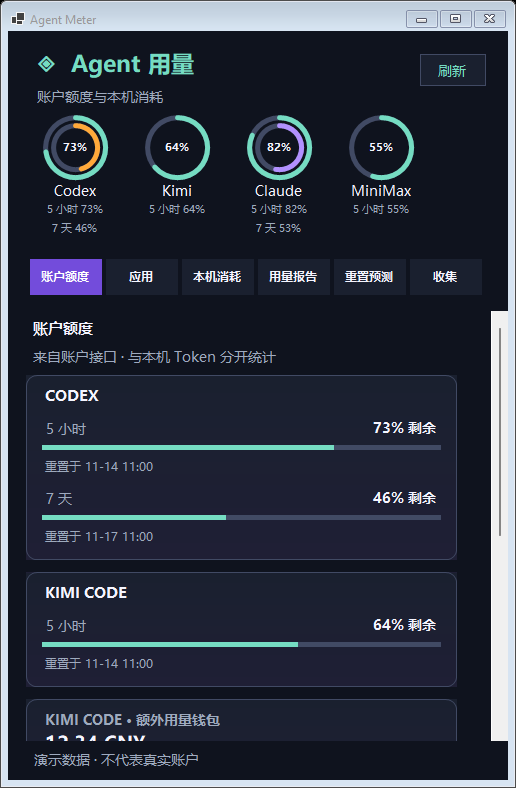
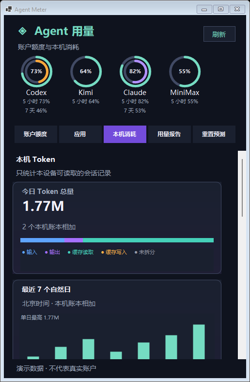
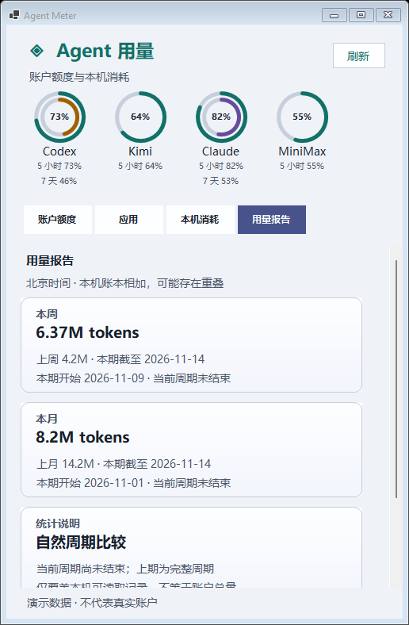
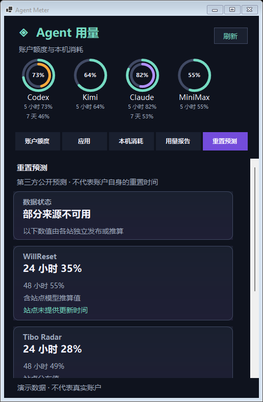
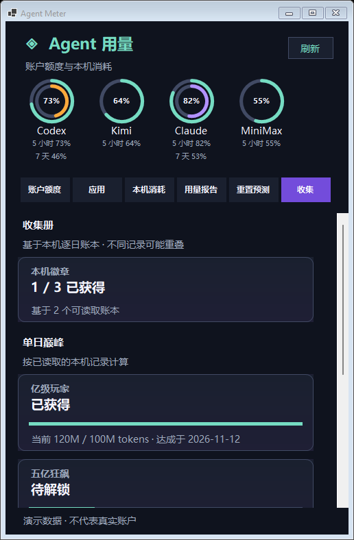
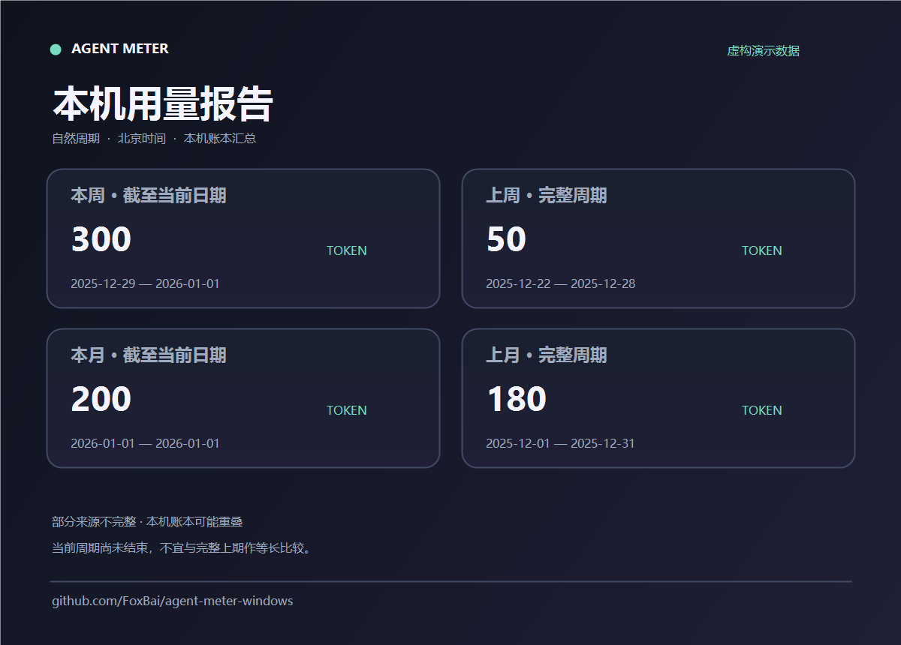

<div align="center">

# Agent Meter for Windows

**AI 编程用量，点开托盘就能看。**

基于 [Gary23333/agent-meter](https://github.com/Gary23333/agent-meter) 开发的 Windows 系统托盘工具，用于查看账户额度和本机 Agent 用量。

[English](README.en.md) · [开始使用](#开始使用) · [隐私与数据](#隐私与数据) · [参与贡献](#参与贡献)

[](https://github.com/FoxBai/agent-meter-windows/actions/workflows/windows-port.yml) [](LICENSE)

</div>

> **Windows 早期开发版。** 当前版本尚未覆盖原 macOS 项目的全部数据源和功能。



截图展示 Alpha 6，在隔离的 Windows 构建环境中使用虚构演示数据生成；窗口边框可能因系统版本而异。实际可显示的字段取决于工具、账户、本机记录和版本。

<details>
<summary>查看本机消耗、报告、预测与收集页面</summary>








</details>

<details>
<summary>查看报告分享图示例</summary>



图片由程序使用虚构数据生成，报告与分享图已包含在预览版中。
</details>

## 功能

- **系统托盘面板**：左键托盘图标显示或隐藏面板，右键可打开、刷新或退出。关闭面板后程序仍留在托盘。
- **账户查询开关**：在托盘右键菜单的「账户查询」中分别启用或关闭 Codex、Kimi、Claude、MiniMax，以及主分支新增的 DeepSeek API 余额读取；本机历史统计不受影响。选择保存在当前 Windows 用户的本地设置中，不包含凭据。MiniMax 和 DeepSeek 默认关闭，其余三个默认开启。
- **低额度提醒**：可在托盘菜单主动开启；受支持的账户窗口剩余量低于 20% 时尝试显示 Windows 通知，同一周期避免重复提醒。提醒默认关闭，Windows 通知权限和实际显示效果仍需实机验证。
- **桌宠（开发中）**：提供上游「麻薯」「比特」两种精灵图形象，默认隐藏；可在托盘菜单显示、切换，单击打开面板或拖动位置。低额度和近期本机记录更新会改变动画。透明穿透、交互及窗口表现尚待实机验证；原版 3D 形象与完整互动仍在移植。
- **界面风格**：托盘菜单提供极简、原生、瓷白、极光、钛影、霓虹、棱镜七种配色与基础卡片样式，并记住选择。Windows 版尚未复现 Mac 版的全部材质与动效，逐套视觉验收仍在进行。
- **Codex 账户额度**：在账户服务提供数据时，展示额度窗口、重置时间、积分及重置卡。未提供的字段不会按零显示。
- **账户分组**：同一服务的多个额度窗口合并到一张卡片，方便同时比较周期；新布局尚待实机验收。
- **双周期仪表**：对同时提供短周期和 7 天额度的账户显示双环；只有一个可识别窗口时显示单环。双环的实际界面尚待实机验证。
- **Kimi Code 账户额度**：尝试连接已经运行的本机 Kimi 服务，不主动启动服务；当前仅通过模拟服务验证，真实 Windows 账户尚待验证。
- **Claude Code 账户额度**：在已有本地订阅凭据文件时，向 Anthropic 的用量接口查询额度；不会刷新或修改原有登录。当前仅通过模拟数据验证，真实 Windows 账户尚待验证。
- **MiniMax Code 账户额度**：支持在托盘菜单添加、更新和删除最多 5 个账户；密钥保存在 Windows 凭据管理器，各账户分开查询。查询默认关闭，须主动开启。账户列表文件不存在时也可使用已有的 `MINIMAX_TOKEN_PLAN_KEY` 与 `MINIMAX_REGION` 环境变量，修改环境变量后需重启程序。仅经模拟测试，真实账户和窗口尚待实机验证。
- **DeepSeek API 余额（主分支开发中）**：通过托盘菜单由用户自行添加或删除 API 密钥，保存后主动启用余额查询；密钥保存在 Windows 凭据管理器，不读取浏览器登录。返回的充值余额和赠金分别显示，不代表订阅额度或本机 Token 消耗。依据 [DeepSeek 官方余额接口](https://api-docs.deepseek.com/zh-cn/api/get-user-balance/)；目前仅经模拟测试，Alpha 6 下载包不包含此功能。
- **本机用量**：读取支持的会话账本，展示今日、近 7 天、近 30 天和累计 Token。Qoder CN 本机积分消耗单独展示，不计入 Token。账户额度和本机历史分别展示，统计范围不同。
- **应用活动**：汇总近 24 小时各客户端活动记录，并标出采集时最近 15 分钟有更新的记录数；这只是记录更新时间，不代表进程仍在运行或任务已完成。不同客户端的覆盖范围可能不同。
- **模型排行**：按近 7 天的本机记录汇总模型用量；当读取出错、模型明细不完整或数量超过采集上限时，界面会标注统计不完整。不同账本可能包含重叠记录，汇总值并非账户总用量。
- **本机趋势**：按北京时间展示最近 7 个自然日的 Token 柱状图；与按过去 7×24 小时统计的排行周期不同。仅汇总支持逐日记录的本机账本，读取不完整时会提示。
- **自然周期报告**：提供本周、上周、本月和上月的本机 Token 汇总，提示当前周期尚未结束；可导出汇总 Markdown 或跟随当前风格的 PNG 分享图。实际导出交互仍待实机验收。
- **重置预测（开发中）**：可在托盘菜单主动开启第三方公开预测，分别展示各站提供的 24 小时、48 小时估计，标注模型推算值和可获得的站点更新时间。默认关闭；模拟测试已通过，一次隔离网络检查中 3 个站点有 2 个返回可用数据，界面交互尚待实机验收。预测不是 OpenAI 官方承诺，也不是个人账户的额度重置时间。
- **收集册（开发中）**：按上游规则从本机逐日账本计算单日、累计、连续使用、多应用及个人纪录徽章；可能重叠的账本会影响结果，不完整来源会标注。签到、图片、花费类徽章和对应卡片尚未移植，界面仍待实机验收。
- **额度掉落卡片（开发中）**：复用上游 5 小时与 7 天窗口的用量阈值，同一窗口的同一等级只记录一次。额度状态和卡片数量保存在本地；缺少可信额度或重置时间时不会猜测掉落。窗口交互和真实账户仍待验收。
- **API 等价估算**：对本机账本中能匹配价格的模型，显示今日美元估算；缺少价格、用量拆分或必要峰谷信息时标注不完整。可从托盘菜单编辑自定义美元价格，覆盖上游内置快照。内置价格可能过时，部分人民币价格按固定汇率 1 美元 = 7.25 元换算；这不是订阅扣费或实际账单。实时价格与汇率同步尚未接入。
- **后台刷新**：账户数据可先显示，历史记录继续在后台扫描。支持手动刷新和每 15 分钟自动刷新；程序运行期间会在内存中缓存已解析的用量，变化的文件会重新读取。

## 数据来源

下表描述当前 `main` 分支，下载包的具体范围以对应发布说明为准。

| 来源 | 账户额度 | 本机 Token 历史 |
| --- | --- | --- |
| Codex | 额度和重置时间；可用时显示积分、重置卡 | 本机会话及归档 |
| Claude Code | 读取已有本地订阅凭据（模拟验证） | 本地项目会话 |
| Gemini CLI | 暂不支持 | 本地聊天会话 |
| WorkBuddy | 暂不支持 | 本地项目会话 |
| ZCode | 暂不支持 | 本地 CLI 用量数据库 |
| DeepSeek Harness | 暂不支持 | 本机会话日志，包含受支持的压缩日志 |
| DeepSeek API | API 余额，主动添加密钥并启用（主分支，模拟验证） | 不直接提供本机历史；DeepSeek Harness 另列 |
| Kimi Code / 旧版 Kimi CLI | Kimi Code 已运行本地服务（模拟验证） | 本机会话日志 |
| OpenCode | 暂不支持 | 本地 v1 消息数据库；检测到 v2 记录时提示统计不完整 |
| MiniMax Code | 最多 5 个独立账户或环境变量密钥，主动开启（模拟验证） | 本机用量数据库 |
| MiMo Code、DevECo | 暂不支持 | 本机用量数据库 |
| Qoder CN | 暂不支持 | 本机积分消耗，不是 Token 或账户余额 |

新增的 Kimi、OpenCode、MiniMax Code、MiMo Code、DevECo 和 Qoder CN 读取器已通过 Windows 模拟数据测试，但尚未在这台 Windows 电脑上用对应真实安装验证；OpenCode v2 消息暂不计入。工具只展示实际读取到的数据。不同账户可能不提供某些字段，应用版本变化也可能影响读取。本机历史只覆盖当前电脑可见的记录，不等于账户总用量、账单或套餐剩余额度。目前“今日”等统计周期按**北京时间（Asia/Shanghai）**划分，不会把不同服务的积分相加。

## 开始使用

### 环境要求

- Windows x64，并在本机安装、配置需要查看的 Agent。本项目已在 Windows build 26300 上进行开发验证；其他系统版本和 Windows ARM64 仍需验证。
- 从源码构建需要 Python 3.10 和 .NET 8 SDK。构建出的独立目录包含 Python 后端和 .NET 运行时。
- 查看 Codex 账户额度需要可用且已登录的 `codex.exe`，其位置应在 `PATH` 中或 Codex Desktop 安装目录内。Agent Meter 不负责登录账户。

### 下载预览版

前往 [Windows v0.1.0-alpha.6 发布页](https://github.com/FoxBai/agent-meter-windows/releases/tag/windows-v0.1.0-alpha.6)，下载 `AgentMeter-Windows-x64.zip`，解压后运行其中的 `AgentMeter.Windows.exe`。便携包已包含运行环境。当前预览版尚未进行代码签名，发布页同时提供 SHA-256 校验文件；完整托盘交互、主题和另一台全新 Windows 实机尚未验证。

### 从源码构建

在项目根目录打开 PowerShell：

```powershell
py -3.10 -m venv .venv-win
.\.venv-win\Scripts\python.exe -m pip install -r windows\requirements.txt
powershell -NoProfile -ExecutionPolicy Bypass -File windows\build.ps1
.\windows\dist\AgentMeter\AgentMeter.Windows.exe
```

请保留完整的 `AgentMeter` 输出目录。启动后在 Windows 通知区域查找图标；如果没有直接看到，可展开隐藏的图标。首次需要扫描已有的本机记录，记录较多时可能耗时较长；程序继续运行期间，后续刷新可以复用内存缓存，但文件变化和缓存淘汰仍会影响速度。

如果只想查看界面，可运行不读取账户和本机历史的演示模式：

```powershell
.\windows\dist\AgentMeter\AgentMeter.Windows.exe --demo
```

排查时可使用 `--window`，以普通任务栏窗口显示真实数据；日常使用无需添加参数。退出程序请右键托盘图标，选择**退出**。

### 运行测试

```powershell
powershell -NoProfile -ExecutionPolicy Bypass -File windows\test.ps1
dotnet build windows\AgentMeter.Windows -c Release
```

上述命令覆盖当前 Windows 适配的重点路径，不代表原项目全部 macOS 功能均已在 Windows 验证。部分上游测试还需要额外工具，或包含针对其他系统的假设。

## 隐私与数据

Windows 适配层读取本机会话文件和用量数据库，提取用量指标，不在面板中展示对话内容。应用活动读取器会访问会话时间和项目路径等元数据，但只向界面传递各应用的汇总计数和更新时间，不传递会话标识、项目路径或内容。解析后的用量只缓存在有限的进程内存中，退出时清除。Windows 界面不上传这些历史记录，也不要求注册 Agent Meter 账户。Codex、Kimi、Claude 账户查询默认开启，MiniMax 和主分支的 DeepSeek API 查询默认关闭；可在托盘菜单分别调整，选择保存在 `%LOCALAPPDATA%\AgentMeter\preferences.json`，只包含开关状态。自定义价格、外观、提醒和桌宠设置保存在同一目录；价格文件无法读取时会隐藏金额并提示。额度提醒只在当前进程内去重，重启后可能再次提示。桌宠素材随程序内置，动画不连接网络。

第三方重置预测默认关闭。开启后会通过 HTTPS 访问 `willreset.com`、`codex-reset.com` 和 `codexreset.org`，不发送账户凭据或本机会话；公开预测及其历史缓存在 `%LOCALAPPDATA%\AgentMeter\reset-forecast.json`，关闭开关不会自动删除缓存。已发出的请求无法撤回。

额度掉落卡片通过本地进程的标准输入传递必要的额度字段和多账户名称，将已观察到的额度窗口、峰值、重置时间与卡片数量保存在 `%LOCALAPPDATA%\AgentMeter\collection.json`，不保存密钥或会话内容。多账户名称以摘要区分；修改账户名称会被视为新的跟踪对象。关闭账户查询后不再获取该账户的新额度，已有本地卡册不会自动删除；账本无法读取时会提示，不会按空账本覆盖。

刷新 Codex 账户数据时，程序会启动本机已安装的 Codex app-server，使用现有登录状态，Codex 可能访问服务提供方。若 Claude Code 本地订阅凭据文件存在，程序会在内存中读取其中的访问令牌，通过 HTTPS 向 Anthropic 用量接口发送该令牌；不会刷新、修改或保存该令牌。用户添加的 MiniMax 密钥由 Windows 凭据管理器保存；账户名称、区域及随机标识保存在本地 `minimax-accounts.json`，不包含密钥。开启查询后，密钥通过子进程标准输入传递，并通过 HTTPS 发往所选区域的 MiniMax 用量接口；不放在命令行或应用日志中。仅在账户列表文件不存在时回退到环境变量；通过界面清空账户后会保留空列表，不会自动使用环境变量。关闭来源时程序会尝试中止当前账户查询，已发出的请求无法撤回。程序不会主动发送模型提示词或兑换积分。

主分支的 DeepSeek API 密钥由用户自行添加并保存于 Windows 凭据管理器；启用查询时经本地子进程标准输入传递，并通过 HTTPS 发往 DeepSeek 官方余额接口，不写入命令行或应用日志。该功能不读取浏览器登录或环境变量中的密钥；可在托盘菜单删除已保存的密钥并关闭查询。

原 macOS 项目的可选积分领取功能没有在 Windows 界面开放。如果工作环境对本机会话访问有要求，请自行检查代码和相应服务的使用规则。

## 常见问题

- **找不到托盘图标**：展开通知区域的隐藏图标；也可以使用 `--window` 检查面板。
- **没有 Codex 额度**：确认 `codex.exe` 可用且已登录，再刷新；网络或服务异常也可能导致暂时不可用。
- **没有本机历史**：确认当前 Windows 用户已使用过相应 Agent，且本机记录仍存在。可通过 `CODEX_HOME`、`CLAUDE_CONFIG_DIR`、`DSH_HOME`、`KIMI_CODE_HOME`、`XDG_DATA_HOME` 和 `OPENCODE_DB` 覆盖对应默认路径。
- **首次刷新较慢**：首次需要解析已有文件，程序保持运行时后续刷新通常较快；文件变化、缓存淘汰或记录过多仍可能影响速度。
- **和官方页面数字不同**：本机历史与账户统计的范围、更新时间不同；缺失或无法识别的字段不会被假定为零。

## 开发与致谢

Windows 原生界面和适配层位于 [`windows/`](windows/)。[`agent_meter/`](agent_meter/) 中的 Python 采集器基于 [Gary23333/agent-meter](https://github.com/Gary23333/agent-meter) 修改，上游基准提交为 [`ac547d0`](https://github.com/Gary23333/agent-meter/commit/ac547d0dd56031cad70c3f0adf6266ce96a69bf9)。原作者版权声明和 MIT 许可保留在 [LICENSE](LICENSE)，上游第三方声明见 [THIRD_PARTY_NOTICES.md](THIRD_PARTY_NOTICES.md)。本项目是独立移植版，并非原项目或任何 Agent 服务商的官方发行版。

## 参与贡献

欢迎提交问题和改进。反馈时请说明 Windows 版本、应用版本、涉及的数据源、预期结果和经过脱敏的复现步骤；不要在公开问题中附上凭据、对话记录或私密账户信息。提交改动前请运行上述针对性测试，并说明尚未验证的平台或数据源。

## 许可证

[MIT](LICENSE)，保留原作者 Gary23333 的版权声明；第三方组件遵循各自许可。
